<a href="https://emcurso.pt">
<picture>
  <source media="(prefers-color-scheme: dark)" srcset="./assets/header-dark.svg" />
  <source media="(prefers-color-scheme: light)" srcset="./assets/header-light.svg" />
  
</picture>
</a>

 

O **EmCurso** acompanha as ocorrências de proteção civil em Portugal à medida que acontecem. Reunimos o que a ANEPC, o IPMA e o ICNF publicam, normalizamos os dados e mostramo-los num mapa em direto — e numa API aberta, para quem quiser construir por cima.

É uma plataforma independente, feita para ser simples de usar, rápida e fiável. Porque é nos piores dias que mais gente precisa dela.

**[emcurso.pt](https://emcurso.pt)** &nbsp;·&nbsp; [api.emcurso.pt](https://api.emcurso.pt) &nbsp;·&nbsp; [Estado do serviço](https://api.emcurso.pt/status) &nbsp;·&nbsp; [Contacto](https://api.emcurso.pt/contacto) &nbsp;·&nbsp; [X](https://x.com/emcursopt)

 

<picture>
  <source media="(prefers-color-scheme: dark)" srcset="./assets/figures-dark.svg" />
  <source media="(prefers-color-scheme: light)" srcset="./assets/figures-light.svg" />
  
</picture>

<picture>
  <source media="(prefers-color-scheme: dark)" srcset="./assets/ecosystem-dark.svg" />
  <source media="(prefers-color-scheme: light)" srcset="./assets/ecosystem-light.svg" />
  
</picture>

<picture>
  <source media="(prefers-color-scheme: dark)" srcset="./assets/sources-dark.svg" />
  <source media="(prefers-color-scheme: light)" srcset="./assets/sources-light.svg" />
  
</picture>

<picture>
  <source media="(prefers-color-scheme: dark)" srcset="./assets/partners-dark.svg" />
  <source media="(prefers-color-scheme: light)" srcset="./assets/partners-light.svg" />
  
</picture>

 

Os dados de origem pertencem às autoridades que os publicam. O EmCurso não é um serviço oficial — **em caso de emergência, ligue 112.**
